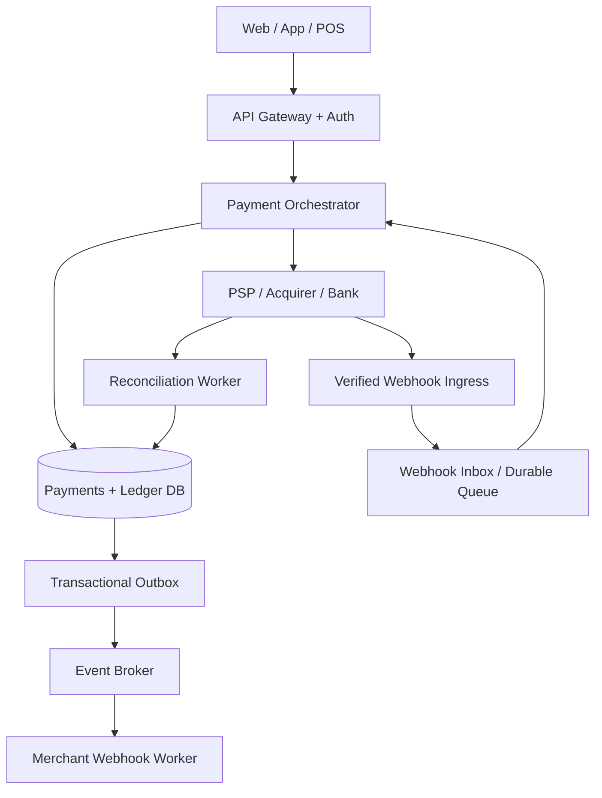
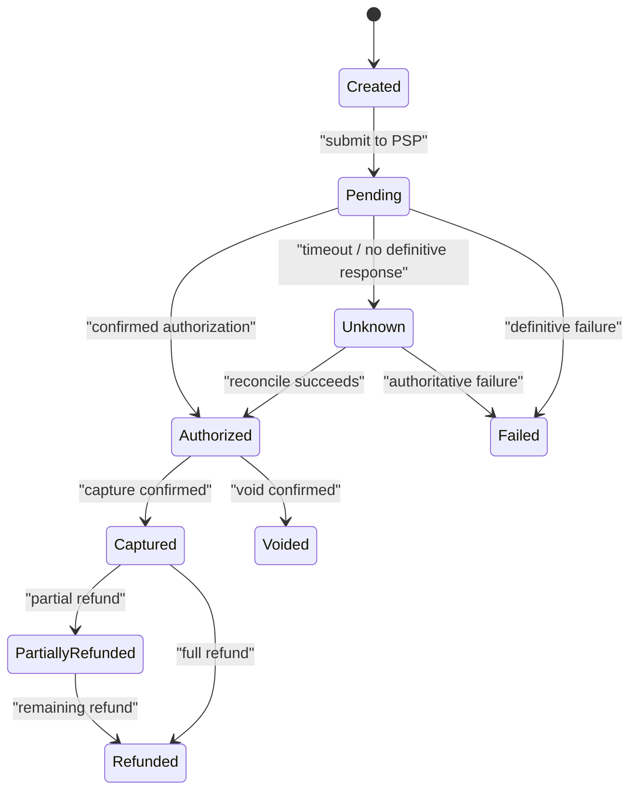

# Case Study — Payment System Architecture: đúng tiền, đúng trạng thái, không ghi trùng

> [← System Design](README.md) · [Twitter/X Feed ←](twitter-x-feed-architecture.md) · [Personal Finance Aggregator →](personal-finance-aggregator-architecture.md) · [Template Solution Architect](../25-software-architecture/system-design-case-study-template.md)

**Bài toán:** Merchant nhận thanh toán qua thẻ/POS/cổng thanh toán, cần tạo yêu cầu, xử lý kết quả bất đồng bộ, theo dõi trạng thái, thông báo merchant và đối soát. Điểm khó là **external outcome UNKNOWN, idempotency, ledger correctness, security và reconciliation**, không phải thêm nhiều queue.

> **Boundary:** Đây là kiến trúc merchant/payment orchestration tham khảo. Không tự nhận đang thiết kế toàn bộ card network, issuer/acquirer hay core banking. API, trạng thái settlement và trách nhiệm tiền thực tế phụ thuộc PSP, phương thức thanh toán, hợp đồng, quốc gia và các nghĩa vụ tuân thủ.

## 1. Requirements và invariants

| ID | Functional requirement | Acceptance / exceptional path |
|---|---|---|
| FR-01 | Tạo payment intent cho order | Same idempotency key + same payload không tạo hai intent; key khác payload trả conflict |
| FR-02 | Confirm / authorize / capture | Biết transaction nào do PSP quyết định, trạng thái nào do hệ thống ghi nhận |
| FR-03 | Xem kết quả sau timeout | `PENDING`/`UNKNOWN` không bị map thành `FAILED`; có status endpoint |
| FR-04 | Nhận PSP webhook | Xác thực chữ ký, replay protection, dedup, eventual state convergence |
| FR-05 | Refund, cancel/void | Không hoàn nhiều hơn số tiền có thể hoàn; late callback có policy |
| FR-06 | Merchant ledger & reconciliation | Posting không trùng, double-entry balance, xử lý discrepancy và audit |

**Các invariant phải nêu rõ:**

1. Một `merchant + idempotency_key` ánh xạ một yêu cầu nghiệp vụ đã ràng buộc payload.
2. Không tạo hai **logical ledger postings** cho cùng một event/transfer.
3. `SUM(debits) = SUM(credits)` cho một journal hợp lệ, dùng integer minor units/decimal chính xác thay vì floating point.
4. External PSP call **không nằm trong cùng ACID transaction** với database của merchant.
5. Timeout không chứng minh PSP chưa trừ tiền; phải có trạng thái `UNKNOWN` và đường reconcile.

**NFR minh họa, cần xác nhận với Product:** Payment API p95 dưới 300 ms cho bước *accept* nội bộ (không hứa settlement hoàn tất), 2 triệu attempts/ngày, peak factor 10, RPO cho ledger theo yêu cầu đã được phê duyệt, 99,95% API availability, audit và khả năng chứng minh reconciliation gap.

## 2. Capacity & boundary estimates

| Measure | Assumption | Estimate |
|---|---|---:|
| Attempts trung bình | 2 triệu/ngày | ~23/s |
| Peak attempts | 10× average | ~231/s |
| Payment API requests | 3 calls/attempt bình quân (hypothetical) | ~694 peak RPS |
| Ledger postings | 2+ entries per journal | Phụ thuộc capture/refund/fees và settlement model |

Thêm webhook retries, user polling, provider outages và reconciliation batches vào capacity model. `2 triệu attempts` **không** có nghĩa `2 triệu successful settlements`.

## 3. HLD: tách request acceptance, provider outcome và ledger



**Card security:** Hosted checkout/secure iframe hoặc PSP Elements có thể khiến PAN không đi qua merchant backend, nhưng **không đồng nghĩa merchant miễn mọi PCI DSS scope**. Đối với thiết bị POS, *validated P2PE* khác với việc nói chung chung “chip được mã hóa”. Token nhận được từ PSP không phải PAN, nhưng vẫn phải xem là dữ liệu nhạy cảm và hạn chế lộ/log.

**Signature terminology:** HMAC dùng **shared secret**, còn chữ ký số bất đối xứng dùng private/public key. Không gọi chung HMAC là “ký bằng private key”. Gửi callback qua HTTPS; xác minh chữ ký từ raw request body theo spec PSP, timestamp và duplicate event ID.

## 4. Payment API và state machine

```http
POST /v1/payment-intents
Idempotency-Key: 6fbb... 
Content-Type: application/json

{"orderId":"ord_123","amountMinor":125000,"currency":"VND","paymentMethodToken":"pm_abc"}
```

```http
GET  /v1/payment-intents/{id}
POST /v1/payment-intents/{id}/capture
POST /v1/refunds
GET  /v1/reconciliation-cases?status=OPEN
```

Mọi API có merchant-level authorization; `POST` nhận idempotency key, payload hash, bounded retention và documented conflict semantics. Refund có idempotency key riêng. `amountMinor` là số nguyên theo *minor unit* của currency; không giả định mọi currency có hai chữ số thập phân.



**Chú ý:** `Settled`, `Disputed`, `Chargeback` là các trạng thái/aggregate khác có thể cần thêm, tùy PSP. Một `Captured` chưa nhất thiết là tiền đã vào merchant bank account.

## 5. Transaction boundaries và ledger

| Entity | Constraints / mục đích |
|---|---|
| `PaymentIntent` | `payment_id`, `merchant_id`, `order_id`, amount/currency, state/version |
| `PaymentAttempt` | unique PSP request reference, request hash, provider result/UNKNOWN |
| `IdempotencyRecord` | unique `(merchant_id, operation, idempotency_key)`, payload hash, result reference |
| `LedgerJournal` | unique business posting key, posting type, immutable audit reference |
| `LedgerEntry` | journal ID, account, debit/credit minor units; balanced journal invariant |
| `WebhookInbox` | unique `(provider_id, provider_event_id)`, verified payload reference, processing status |
| `OutboxEvent` | immutable event ID, aggregate/version, payload, publishing state |
| `ReconciliationCase` | expected vs provider/bank record, discrepancy, resolution/audit |

**Local ACID transaction ví dụ:** Khi nhận `CaptureConfirmed` hợp lệ, một transaction có thể (1) kiểm tra inbox/event đã xử lý, (2) chuyển state, (3) ghi ledger journal + entries nếu thực sự có obligation nội bộ, và (4) ghi `OutboxEvent`. Sau commit mới phát event cho hệ thống khác.

Không dùng `UPDATE merchant.balance = balance + amount` đơn độc làm bằng chứng ledger chính xác. Nếu merchant chỉ là đơn vị điều phối và PSP mới giữ số dư thực, nội bộ không được tự nhận source of truth của settlement. Ledger mô hình nghĩa vụ nội bộ và phải đối soát với provider statements.

## 6. End-to-end flows

### Happy path

1. Client dùng hosted checkout/payment token theo contract PSP.
2. Orchestrator tạo intent + idempotency record trong DB; kiểm tra tiền, currency, merchant/order authorization.
3. Provider adapter gửi yêu cầu có provider-specific idempotency/correlation reference.
4. Nếu PSP xác nhận ngay: ghi state hợp lệ; nếu asynchronous: trả `202` + payment ID.
5. Webhook verified hoặc status reconciliation xác nhận definitive outcome; inbox dedup rồi commit state/ledger/outbox.
6. Merchant notification worker gửi webhook bất đồng bộ, retry + signing; merchant cũng phải dedup.

### Timeout sau khi PSP có thể đã charge

1. Adapter timeout; ghi `UNKNOWN`, **không tự tạo attempt mới với reference khác**.
2. Trả client `202 Accepted`/status URL theo API contract; tránh gọi retry một cách mù quáng.
3. Reconciliation job query PSP bằng stable payment reference hoặc chờ webhook.
4. Resolve `UNKNOWN` sang trạng thái có bằng chứng; nếu provider không xác nhận được, mở manual review case.

### Polling khi pending

Ưu tiên provider webhooks và server-to-server reconciler. Client/POS polling status chỉ đọc **trạng thái nội bộ**, áp bounded rate limit, exponential backoff + jitter và cache khi phù hợp. TTL cache không bao giờ thay thế durable state; một timeout 60 giây không tự biến giao dịch thành `FAILED`.

## 7. Transactional Outbox + CDC, không hứa exactly-once

- SQL commit `PaymentStateChanged` và outbox cùng một transaction.
- CDC (chẳng hạn Debezium đọc WAL) hoặc outbox poller chuyển record sang Kafka.
- Consumer có `Inbox/EventId` unique, transaction update và retry/DLQ/replay.
- Debezium/CDC có thể phát lại sau restart; relay commit/offset không bảo đảm exactly-once từ DB tới mạng bên ngoài.
- Nếu Kafka ghi sự kiện phục vụ archive, S3 chỉ là archive khi đã có retention, encryption, access control, lifecycle và replay requirements rõ ràng.

**Tài liệu:** [Debezium Outbox Event Router](https://debezium.io/documentation/reference/stable/transformations/outbox-event-router.html) · [Stripe — server-side payment events](https://docs.stripe.com/payments/existing-customers).

## 8. Failure/security/operations review

| Failure | Sai lầm nguy hiểm | Correct behavior / test |
|---|---|---|
| Client gửi POST hai lần | Charge hai lần | Business idempotency + unique record; test concurrent requests |
| PSP charge thành công nhưng HTTP timeout | Đánh dấu FAILED, gửi charge mới | `UNKNOWN` + stable provider ref + reconciliation |
| Webhook bị replay hoặc đến out-of-order | State chuyển lùi; double posting | Signature, inbox event ID, state version/transitions; replay test |
| DB commit nhưng broker down | Mất event merchant notification | Outbox lưu bền vững + relay retry |
| Kafka redelivery / worker crash | Hai ledger journals | Unique business posting key + idempotent consumer |
| Merchant webhook endpoint down | Notification thất bại | Bounded retry, DLQ/manual replay, delivery status, signature |
| DB failover/replica lag | Client đọc trạng thái cũ | Strong/primary read cho critical status; consistency contract rõ |
| Provider settlement khác internal records | Mất hoặc sai nghĩa vụ tài chính | Reconcile files/statements, discrepancy workflow, audit trail |

**Security checklist:** payment-token scope, PCI DSS responsibility review, encryption, KMS/Vault, least privilege, multi-tenant BOLA, anti-replay, redaction/no PAN or secret in logs, immutable audit, segregation of duties, disaster recovery drill.

**SLI/SLO gợi ý:** `intent_accept_latency_p95`, `unknown_payment_age`, `webhook_processing_lag`, `reconciliation_discrepancy_count/value`, `duplicate_posting_detected=0`, `provider_timeout_rate`, `ledger_imbalance_detected=0`. Kiểm thử phục hồi backup và báo cáo RPO/RTO, không hứa zero-data-loss nếu thiếu evidence.

## 9. ADR mẫu & bài thực hành

**ADR: webhook + reconciliation hay chỉ synchronous provider call?** Chọn webhook + reconciliation khi PSP xử lý bất đồng bộ và timeout unknown; đánh đổi thêm inbox, state machine và vận hành. Không lấy provider HTTP 200 làm bằng chứng tiền đã settlement.

**Lab đề xuất:**

1. `POST /payment-intents` với 100 concurrent duplicates: đúng **một** logical intent/charge reference.
2. PSP simulator xử lý thành công rồi ngắt kết nối: state `UNKNOWN` được reconcile, không double-charge.
3. Webhook `captured` gửi 5 lần và out-of-order cùng `failed`: ledger không double-post và không chuyển lùi sai.
4. Outbox relay crash trước/sau ack broker: event replay idempotent.
5. Merchant webhook fail 3 lần, rồi khôi phục: gửi lại có audit, không giữ payment DB transaction.
6. Chứng minh double-entry balance và reconciliation discrepancy qua SQL integration test.

**Học tiếp:** [Distributed Systems / Idempotency](../17-distributed-systems/partial-failure-timeouts-retries-and-idempotency.md) · [Outbox / Inbox](../17-distributed-systems/messaging-outbox-inbox-and-dedup.md) · [Solution Architect Governance](../25-software-architecture/solution-architecture-delivery-governance.md).
