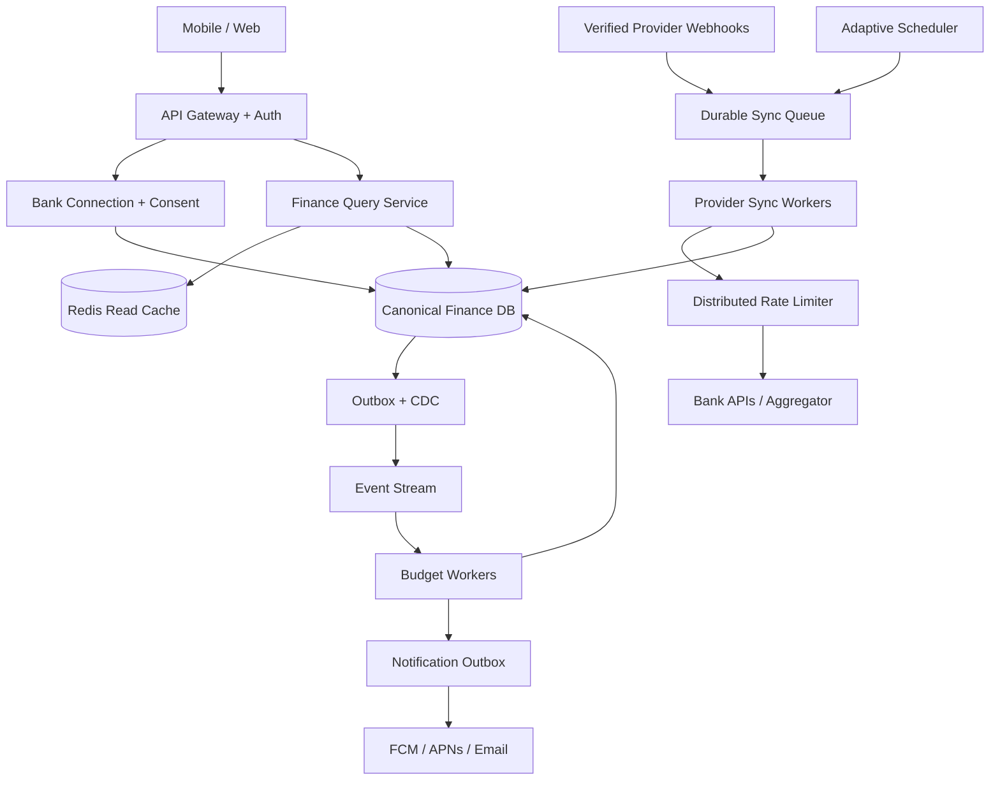

# Case Study — Personal Finance Aggregator: nhiều ngân hàng, một dashboard

> [← System Design](README.md) · [Payment Architecture ←](payment-system-architecture.md) · [Case studies & review](case-studies-and-design-review.md) · [Template Solution Architect](../25-software-architecture/system-design-case-study-template.md)

**Bài toán:** Người dùng kết nối nhiều ngân hàng, hợp nhất giao dịch, theo dõi ngân sách và nhận cảnh báo vượt mức chi tiêu mà không làm quá quota API của đối tác. Đây là case **external integration, data freshness, change semantics, rate limiting, event processing và privacy**.

> **Sự thật thiết kế:** “Real-time alert” chỉ có nghĩa gần-real-time **sau khi dữ liệu được ứng dụng nhận**. Nếu ngân hàng chỉ cung cấp giao dịch mới sau vài giờ, Redis/Kafka/CDC không làm dữ liệu xuất hiện sớm hơn. Với Plaid, việc kiểm tra giao dịch thường từ 1–4 lần/ngày tùy tổ chức; `SYNC_UPDATES_AVAILABLE` báo dữ liệu có thay đổi nhưng không biến API thành real-time feed.

## 1. Actors, FR và NFR

| ID | Functional requirement | Acceptance / exceptional flow |
|---|---|---|
| FR-01 | Link/unlink nhiều bank accounts | Consent rõ ràng, revoke/disconnect có hiệu lực và audit |
| FR-02 | Xem balances và giao dịch tổng hợp | Ghi rõ `lastSuccessfulSyncAt`, độ tươi theo từng bank; currency chính xác |
| FR-03 | Refresh/sync theo lịch và webhook | Không chạy quá quota; xử lý expired consent, 429 và downtime |
| FR-04 | Phân loại, lọc, tìm giao dịch | Không đếm trùng pending/posted, account transfer, reversal/refund |
| FR-05 | Tạo ngân sách theo category/month | Kỳ tính theo timezone, currency và policy pending/posted xác định |
| FR-06 | Gửi cảnh báo threshold | Không gửi trùng khi replay; hỗ trợ threshold 80/100/120%, preference |
| FR-07 | Xóa dữ liệu và rút consent | Thực thi retention/deletion theo hợp đồng, policy và luật áp dụng |

**NFR minh họa** (chưa phải SLA đã cam kết): dashboard p95 dưới 300 ms trên dữ liệu đã cache; API availability 99,9%; budget evaluation p95 dưới 5 giây sau **DB commit**; không phát sinh vượt quota đã biết; 0 logical duplicate transaction/alert; freshness hiển thị riêng cho mỗi connection; secure token lifecycle và audit.

**Out of scope phase đầu:** chuyển tiền, trading, credit scoring, AI dự báo, open banking consent tại các quốc gia chưa có quyền tích hợp. Nếu thêm write-to-bank operations, phải review lại security/invariants toàn bộ.

## 2. Capacity model: quota là bottleneck thật

Giả định (để luyện capacity, không phải hạn mức của ngân hàng thực):

```text
100.000 connected accounts
2 API calls / full synchronization
1 shared provider quota = 200 requests / minute
```

Một lần refresh toàn bộ cần `100.000 × 2 = 200.000 calls`. Thời gian tối thiểu `200.000 / 200 = 1.000 phút`, tương đương **16 giờ 40 phút** — chưa tính retries, pagination và ưu tiên traffic.

**Kết luận:** tăng Worker không giải quyết giới hạn quota ngoài hệ thống. Cần **webhook-first, incremental sync, scheduling priorities, batching/coalescing và adaptive polling**. Phân biệt giới hạn theo provider, endpoint, app, bank connection/consent và hợp đồng thực tế.

## 3. HLD: sync pipeline tách biệt read dashboard



**Source of truth:** normalized transactions, consent states, sync cursors và budget records ở durable DB. Redis chỉ làm read cache/rate-limit state, không thay bank data truth. Kafka là kênh thay đổi nội bộ, **không thay thế bank sync**.

## 4. Connection flow & API contracts

```http
POST   /v1/bank-connections               # Initiate consent/link flow
GET    /v1/bank-connections               # Connection status, last sync
DELETE /v1/bank-connections/{connectionId} # Revoke/disconnect
GET    /v1/accounts
GET    /v1/transactions?accountId=...&cursor=...&limit=50
POST   /v1/budgets
GET    /v1/budgets/{id}/usage
POST   /v1/bank-connections/{id}/refresh
GET    /v1/sync-status
```

- API login dùng OIDC/OAuth phù hợp; bank linking sử dụng **authorized consent flow** hoặc licensed aggregator. Không mặc định thu thập username/password ngân hàng.
- Return state/redirect/callback phù hợp provider. Xác thực `state`, PKCE nếu được hỗ trợ/áp dụng, origin và anti-CSRF; scopes tối thiểu.
- Bank access/refresh tokens được mã hóa bằng KMS/Vault hoặc cơ chế tương đương; DB chỉ lưu token reference nếu có thể. **Không lưu token plaintext trong JSON/log.**
- Không tin `userId` tự gửi lên để quyết định quyền; mọi truy vấn phải bảo vệ object/tenant ownership.
- Refresh API **không đồng nghĩa gọi ngay bank**. Có thể coalesce và enqueue, trả `202` + status/job reference khi cần.

## 5. Adaptive polling & token bucket

```text
Provider webhook ─┐
User refresh ─────┼──> dedup per connection ─> durable job queue
Scheduled refresh ┘                                     │
                                               priority + nextRunAt
                                                        │
                                           distributed quota lease
                                                        │
                                             provider incremental API
```

**Sync worker algorithm:**

1. Claim một job bằng lease có thời hạn và idempotency; không chạy hai sync cho cùng connection nếu không có cơ chế concurrency an toàn.
2. Kiểm tra consent/token state; ưu tiên webhook báo có dữ liệu thay vì polling mọi account mỗi vài phút.
3. Acquire rate-limit permit atomically (ví dụ Redis Lua/token bucket); phân tách quota theo nhà cung cấp, account/endpoint và app.
4. Gọi bank với timeout/connection pool giới hạn; với `429` tuân `Retry-After` nếu có, backoff + jitter, đưa lại job vào queue thay vì giữ thread ngủ.
5. Khi 5xx/outage liên tục: circuit breaker + fair scheduling; ngân hàng A lỗi không làm chết sync ngân hàng B.
6. Sync `added/modified/removed` theo cursor nếu API hỗ trợ, apply idempotently và **commit cùng cursor/checkpoint** theo batch hợp lệ.
7. Lưu `lastProviderDataAt`, `lastSuccessfulSyncAt`, `nextEligibleSyncAt`, lỗi và trạng thái còn stale.

**Khi cursor invalid:** theo protocol provider, restart from known safe cursor/full resync có checkpoint, không chỉ skip trang lỗi để tránh mất giao dịch.

## 6. Giao dịch ngân hàng không phải append-only

Tài liệu [Plaid Transactions states](https://plaid.com/docs/transactions/transactions-data/) nêu pending → posted có thể xuất hiện dưới dạng **removed pending + added posted** với transaction ID khác; cập nhật `/transactions/sync` có các nhóm `added`, `modified`, `removed` cần được áp dụng đầy đủ.

| Case | Không nên làm | Chính sách đúng cần thiết kế |
|---|---|---|
| Pending chuyển Posted | Cộng thêm như giao dịch mới độc lập | Liên kết/reconcile nếu có evidence; đánh giá lại số chi |
| Refund/reversal | Xem như chi tiêu mới | Ghi nhận dấu/loại và điều chỉnh budget theo policy |
| Chuyển tiền giữa tài khoản sở hữu | Đếm double expense | Match transfer và loại khỏi category spending nếu người dùng đồng ý |
| Provider sửa transaction/category | Chỉ consume `INSERT` | Process `UPDATE/DELETE`, re-evaluate buckets bị ảnh hưởng |
| Giao dịch ngoại tệ | Cộng thẳng số không cùng currency | Convert theo rate policy có timestamp/rounding rõ ràng |
| Pending chưa settled | Không phân biệt | Chọn tính `posted only` hoặc `pending included` và giải thích UI |

## 7. Data model & event contract

| Entity | Primary / unique constraint | Quan trọng |
|---|---|---|
| `BankConnection` | `(user_id, provider_connection_id)` | Consent scopes, expiry, active/revoked, token reference |
| `BankAccount` | `(connection_id, provider_account_id)` | Account metadata, currency, masking |
| `SyncJob` | `job_id` + dedup key | lease, attempt, next_run_at, priority |
| `SyncCursor` | unique `connection_id` | last committed cursor/page checkpoint; version |
| `Transaction` | `(provider_id, account_id, provider_transaction_id)` | status, normalized amount, effective/posted date, version |
| `Budget` | `budget_id`, owner, category, currency, period/timezone | Thresholds, edits, start/end |
| `BudgetUsage` | `(budget_id, period_id)` | Derived aggregate; có thể rebuild |
| `BudgetAlert` | unique `(budget_id, period_id, threshold, crossing_id)` | Dedup semantic alerts, user preferences |
| `InboxEvent` / `OutboxEvent` | stable unique `event_id` | Consumer replay, DB → broker consistency |

Ví dụ event chuẩn hóa (không nhét token/PII nhạy cảm vào Kafka):

```json
{
  "eventId": "evt_1001",
  "type": "TransactionChanged",
  "schemaVersion": 1,
  "userId": "usr_1",
  "accountId": "acct_3",
  "transactionId": "txn_52",
  "transactionVersion": 4,
  "changedCategories": ["FOOD", "TRANSFER"],
  "occurredAt": "2026-11-06T08:30:00Z"
}
```

**Partition by `userId`:** giúp giảm tranh chấp khi tính budget của một user, nhưng **không đủ bảo đảm exactly-once**. Sau consumer rebalance, crash/replay vẫn có duplicate; cần event inbox/unique constraints/version check, và single-writer/optimistic concurrency cho budget nếu có nhiều producer.

## 8. Budget evaluation & notification flow

1. Normalized transaction changes và outbox được commit atomically.
2. CDC/outbox relay publish `TransactionChanged` lên broker; worker dedup theo `eventId`.
3. Re-evaluate ngân sách chịu ảnh hưởng (cả category cũ và mới nếu transaction bị sửa) bằng dữ liệu canonical.
4. Áp chính sách timezone, start/end period, pending/posted, transfers, refunds và FX.
5. Nếu **vượt ngưỡng lần đầu** hoặc crossing mới theo rule: ghi `BudgetAlert` + notification outbox trong một local transaction.
6. Worker gửi APNs/FCM/Email async, lưu attempts và delivery response. Timeout có thể là outcome unknown nên cần retry/dedup ở mức có thể kiểm soát.

**Alert semantics cần Product quyết:** Sau refund, usage giảm dưới 100% rồi tăng vượt 100% lần nữa, có gửi cảnh báo lại không? `crossing_id` là policy-boundary, không chỉ một UUID bất kỳ. Cần quiet hours, notification preference, rate limiting và suppression khi batch historical backfill.

**Không coi CDC là real-time bank feed.** CDC đo được lag từ DB sang Kafka; monitor riêng **source freshness**: lần gần nhất provider có dữ liệu và lần sync thành công.

## 9. Security, HA/DR và các failure modes

| Failure | Detection | Mitigation / recovery evidence |
|---|---|---|
| Consent/token expired, revoked | Provider error, consent status | Mark reconnect required, không retry vô hạn; test revoke |
| API 429 / vendor outage | HTTP code, throttled job count | Retry-After, jitter, circuit breaker, fair queue; load simulate quota |
| Webhook gửi trùng/bị mất | Delivery event ID, lag | Signature + inbox dedup, periodic reconciliation polling |
| Worker chết giữa các page | Lease expiry, unfinished cursor | Atomic checkpoint + re-run page, idempotent upsert |
| Provider sửa/xóa transaction cũ | Delta feed, reconciliation | `added/modified/removed`, rebuild affected budgets |
| CDC/Kafka down hoặc lag | Replication/WAL, connector and consumer lag | Outbox retention, WAL monitoring, replay, dead-letter diagnostics |
| Budget Worker redelivery | Duplicate events/count mismatch | Unique alert key, deterministic calculation, inbox dedup |
| Redis down | Cache miss/rate-limit unavailable | Fail-safe limiter policy và DB-backed state; không thả vô hạn bank traffic |
| Notification provider timeout | Delivery timeout | Bounded retry, audit, suppress duplicates best effort |

**SLIs:** `provider_api_429_rate`, `sync_queue_oldest_age`, `time_since_last_successful_sync`, `time_since_provider_latest_transaction`, `transaction_reconciliation_gap`, `budget_evaluation_lag`, `duplicate_alert_count`, `connector_wal_retained_bytes` và API p95/p99. Hotstore/coldstore chỉ triển khai khi rõ retention, read pattern, archive restore, encryption và quyền xóa dữ liệu.

## 10. ADR mẫu & bài thực hành

**ADR: webhook-first + incremental sync thay vì aggressive polling.** Chọn nếu provider có webhook/delta API; giảm quota và có staleness metadata. Phải chấp nhận webhook bị mất/chậm, nên cần periodic reconciliation. Revisit khi vendor contract hoặc business SLA thay đổi.

**Lab/acceptance checklist:**

1. Mô phỏng provider quota 100 req/phút, 1.000 connections; xác minh thực tế không vượt quota và queue drain dự đoán được.
2. Provider trả 429, 5xx và timeout xen kẽ; không retry storm hoặc vô hạn worker sleep.
3. Replay cùng delta page 5 lần, pending → posted, refund và delete; tổng chi không bị đếm trùng.
4. Worker crash sau DB write nhưng trước ack queue; cursor và transaction vẫn nhất quán.
5. Simulate 100 concurrent transaction events cho cùng user; crossing 100% chỉ có một logical alert.
6. Token bị revoke; người dùng thấy reconnect status, secret không xuất hiện trong logs/traces.
7. Đo `bank freshness` và `Kafka lag` độc lập; không báo dashboard “real-time” khi dữ liệu ngân hàng stale.

**Nguồn chính thống:** [Plaid Transactions Webhooks](https://plaid.com/docs/transactions/webhooks/) · [Plaid Transactions Sync API](https://plaid.com/docs/api/products/transactions/) · [Plaid Transactions Data](https://plaid.com/docs/transactions/transactions-data/) · [Debezium Outbox](https://debezium.io/documentation/reference/stable/transformations/outbox-event-router.html).

**Học tiếp:** [Integration & Security](../25-software-architecture/integration-security-platform-architecture.md) · [Data Architecture](../25-software-architecture/data-architecture-polyglot-persistence.md) · [Architecture Review Playbook](../25-software-architecture/architecture-review-playbook.md).
