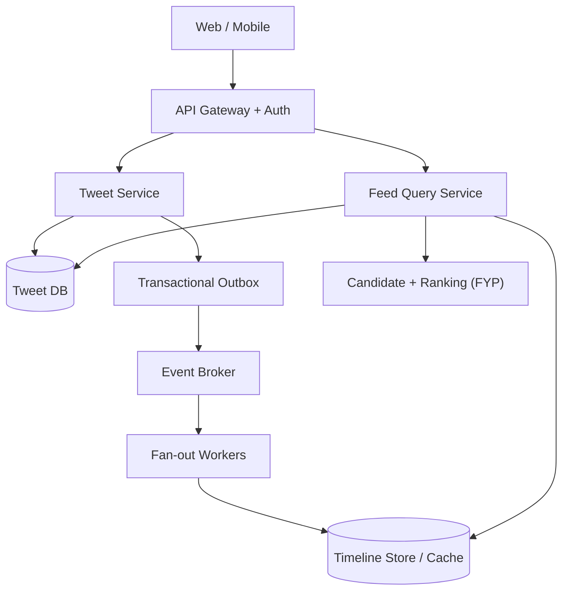

# Case Study — Thiết kế Twitter/X Feed ở quy mô lớn

> [← System Design](README.md) · [Case studies & review](case-studies-and-design-review.md) · [Payment Architecture →](payment-system-architecture.md) · [Template Solution Architect](../25-software-architecture/system-design-case-study-template.md)

**Bài toán:** Người dùng đăng bài, theo dõi người khác và xem Home Timeline nhanh dù có hàng triệu người hoạt động. Đây là case **fan-out, read/write asymmetry, caching, consistency và hot-key**; không phải bài tập bắt buộc sử dụng Kafka hay Redis.

> **Phân biệt hai sản phẩm:** *Following feed* (bài của tài khoản đang theo dõi) có thể dùng mô hình fan-out. *For You / FYP* là sản phẩm gợi ý, cần candidate retrieval, ranking, feature freshness, safety và experimentation riêng. Redis timeline đơn thuần không giải quyết đầy đủ FYP.

## 1. Làm rõ scope, FR và NFR

| ID | Yêu cầu | Acceptance / quyết định cần hỏi |
|---|---|---|
| FR-01 | Đăng, xóa bài; đính kèm ảnh/video | Bài đã xác nhận được tìm thấy trong profile; media tải qua object storage |
| FR-02 | Follow/unfollow, xem Following feed | Bài mới xuất hiện trong feed theo mức độ trễ đã cam kết; không hiện bài của tài khoản đã block |
| FR-03 | Like/repost, xem engagement | Retry không làm tăng count hai lần; counter có thể cập nhật chậm |
| FR-04 | Cursor pagination, refresh feed | Không lặp vô hạn, bỏ sót có giải thích khi dữ liệu mới xen vào |
| FR-05 | Privacy, mute/block, delete | Quyền xem được kiểm tra tại read path, có quy trình gỡ nội dung đã cache |
| FR-06 | FYP, search, quảng cáo, DM | Tách thành bounded context hoặc phase khác, không gộp tất cả vào Tweet Service |

**NFR giả định cho bài tập** (không phải số liệu hoạt động của X): 100 triệu MAU, 10 triệu DAU, 2 triệu bài/ngày, 20 lần mở feed/DAU/ngày, peak factor 5; API đọc feed p95 dưới 500 ms tại vùng phục vụ; availability đọc feed 99,95%; timeline có thể trễ vài giây theo SLO; bài riêng tư/xóa/block phải tuân thủ policy nghiêm ngặt hơn freshness thông thường.

**Câu hỏi phỏng vấn quan trọng:** 100 triệu *users* không đồng nghĩa 100 triệu *concurrent users*. Cần hỏi peak concurrent sessions, request/second, followers distribution, địa lý và read/write ratio.

## 2. Capacity estimate có thể kiểm tra

| Chỉ số | Công thức với giả định | Kết quả |
|---|---|---:|
| Tweet write trung bình | 2.000.000 / 86.400 | ~23/s |
| Tweet write đỉnh | 23 × 5 | ~116/s |
| Feed requests trung bình | 10.000.000 × 20 / 86.400 | ~2.315/s |
| Feed requests đỉnh | 2.315 × 5 | ~11.575/s |
| Fan-out target/ngày nếu trung bình 200 followers | 2.000.000 × 200 | 400 triệu deliveries |

**Cảnh báo:** `average follower count` che giấu heavy-tail: một tác giả có 20 triệu followers tạo một spike rất khác tác giả có 200 followers. Cần phân tích p95/p99 followers, celebrity traffic và chi phí fan-out từng nhóm.

## 3. HLD: hybrid fan-out



### Write path: đăng bài

1. Gateway xác thực; Tweet Service áp idempotency theo `authorId + clientRequestId` và validate quyền đăng.
2. DB commit `Tweet` và `OutboxEvent` trong **cùng local transaction**. Không publish Kafka trong lúc đang giữ DB transaction mở.
3. Relay/CDC publish `TweetCreated`; consumer có inbox/dedup và xử lý retry/replay.
4. Fan-out Workers lấy followers từ nguồn dữ liệu có thể phân trang, tạo timeline entries theo batches; tránh đọc toàn bộ followers của celebrity vào RAM.
5. Với tác giả có fan-out quá lớn, **không materialize cho mọi follower**; đọc bài mới từ celebrity nguồn tại read path và merge với timeline đã materialize.
6. Media upload qua presigned URL/object storage, qua scan/transcode rồi mới phục vụ qua CDN; sự kiện bài đăng không mang binary media.

### Read path: Following feed

1. Lấy candidate IDs từ timeline store với cursor ổn định.
2. Merge với bài của nhóm tác giả `fan-out-on-read` nếu dùng hybrid.
3. Hydrate nội dung và user metadata theo batch; cache để giảm N+1 queries.
4. **Filter quyền xem lại** (block, private account, deleted/takedown) trước khi trả kết quả.
5. Có thể score/rank, rồi trả `items`, `nextCursor`, `generatedAt` và chính sách de-dup.

### Vì sao không dùng fan-out-on-write 100%?

| Phương án | Lợi ích | Giới hạn / khi nào dùng |
|---|---|---|
| Fan-out-on-write | Read nhanh, chi phí lookup thấp | Write amplification, celebrity hot spot, account-follow changes |
| Fan-out-on-read | Write gọn, không nhân bản entry | Query fan-in nặng nếu follow nhiều người |
| **Hybrid** | Kiểm soát write amplification và read latency | Phức tạp merge, duplicate, ordering và invalidation |

## 4. API và mô hình dữ liệu

```http
POST /v1/tweets
Idempotency-Key: 4929d8... 
Content-Type: application/json

{"text":"Hello","mediaIds":[]}
```

```http
GET /v1/timelines/following?limit=50&cursor=eyJ...
POST /v1/tweets/{tweetId}/likes
DELETE /v1/tweets/{tweetId}/likes
POST /v1/users/{userId}/follow
DELETE /v1/users/{userId}/follow
```

Không nhận `authorId` từ body làm căn cứ sở hữu; suy ra identity từ token. Return `401/403/404/409/429` có semantics và contract rõ. Cursor chứa `sortKey + tieBreakerId + snapshot/version` hoặc dạng opaque tương đương, không dùng offset khi traffic lớn.

| Entity | Key / invariant | Lưu ý |
|---|---|---|
| `Tweet` | `tweet_id`, `author_id`, `created_at`, `visibility`, `deleted_at` | Content source of truth; soft-delete có policy retention |
| `Follow` | unique `(follower_id, followee_id)` | Block/privacy cần precedence rõ |
| `Like` | unique `(user_id, tweet_id)` | Count là derived value, có thể rebuild |
| `TimelineEntry` | unique `(viewer_id, tweet_id, source)` | TTL/window trimming; source derived, không phải truth |
| `OutboxEvent` | `event_id`, `aggregate_id`, `version` | Event order trong phạm vi aggregate; replay được |
| `UserSettings` | privacy/mute/block | Security-sensitive invalidation không chờ cache TTL dài |

**Partitioning:** `authorId` giúp ordering sự kiện của một tác giả; `viewerId` giúp quản lý queue feed của một người. Không có một partition key tối ưu mọi access pattern. Nếu một tác giả quá nổi tiếng, một partition theo `authorId` có thể thành hot partition; chia work fan-out sau khi bảo toàn thứ tự/semantics đầu vào.

## 5. Các failure mode cần review

| Failure | Biểu hiện | Thiết kế phục hồi / test |
|---|---|---|
| Publish event thất bại sau khi DB commit | Bài có trong profile nhưng chưa vào feed | Outbox + retry; kiểm tra relay restart và replay |
| Worker nhận lại event | Bài bị lặp trên timeline | Unique key / consumer dedup; replay cùng event 10 lần |
| Celebrity đăng liên tục | Write amplification làm nghẽn fan-out | Fan-out-on-read threshold, bounded batch, queue isolation |
| Redis/cache unavailable | Feed lỗi hoặc latency tăng | Bounded DB fallback, circuit breaker, stale nếu policy cho phép |
| Người dùng xóa bài hoặc block người xem | Bài cũ vẫn nằm trong cache | Read-time authorization + tombstone/invalidation + audit |
| Unfollow trong khi fan-out đang chạy | Timeline chứa entry từ người đã unfollow | Eligibility filter tại read; eventual cleanup |
| Slow consumer / queue lag | Feed trễ vượt SLO | Lag dashboard, autoscaling theo queue age, load shedding |
| Cursor pagination khi có bài mới | Lặp/mất bài giữa trang | Stable keyset cursor, dedup theo ID và documented refresh semantics |

## 6. Security, observability, HA/DR

- **Security:** authn/authz, BOLA, anti-spam/abuse rate limits, content moderation, privacy graph, encryption in transit, audit cho moderation.
- **Observability:** feed p50/p95/p99, `tweet_to_following_visible_seconds`, fan-out queue age, celebrity fallback ratio, cache hit ratio, duplicated/tombstoned content detected.
- **Reliability:** DB backup + restore drill, broker retention đủ replay, Redis rebuilding strategy, zone outage test; quyết định RTO/RPO theo yêu cầu thật.
- **Cost:** fan-out writes/ngày, timeline cardinality/retention, hot-key rate, bandwidth/CDN, read hydration hits và ranking compute.

## 7. ADR mẫu: hybrid fan-out hay thuần on-write?

**Context:** following feed read-heavy, followers distribution lệch lớn; low latency quan trọng nhưng có giới hạn chi phí write/queue.

**Decision có điều kiện:** materialize feed cho ordinary authors, merge on-read cho celebrity authors. `celebrity threshold` chỉ quyết định sau khi đo histogram followers và queue throughput.

**Alternatives:** (A) fan-out-on-write toàn bộ — đơn giản ở read nhưng spike; (B) fan-out-on-read toàn bộ — đơn giản ở write nhưng query đắt.

**Consequence:** tăng logic merge và test de-dup; giảm nguy cơ fan-out bùng nổ. **Revisit trigger:** p99 hydration latency, queue age hoặc cost/user vượt budget.

## 8. Bài tập / tiêu chí nghiệm thu

1. Thiết kế 2 sequence flows: người thường đăng bài và celebrity đăng bài; đánh dấu điểm commit/event.
2. Viết load model cho **100 triệu concurrent** khác gì **100 triệu MAU**, xác định network/edge assumptions cần có.
3. Lab 1: 100 concurrent likes cùng `(user,tweet)` không tăng count quá 1; test bằng database thật.
4. Lab 2: replay một `TweetCreated` 10 lần mà feed không nhân bản entry.
5. Lab 3: unfollow/block/delete đồng thời với fan-out; người không có quyền không nhìn thấy nội dung.
6. ADR: lựa chọn fan-out, cache và pagination; nêu ngưỡng đo để đổi chiến lược.

**Self-review:** Không gọi hệ thống này “production ready” chỉ vì có diagram. Cần load test có phân phối followers thực tế, kiểm thử policy và kiểm tra lag/failure/replay.

**Học tiếp:** [Async, Queue & Backpressure](async-queues-backpressure-and-reliability.md) · [Data Partitioning & Consistency](data-partitioning-replication-and-consistency.md) · [Architecture Review Playbook](../25-software-architecture/architecture-review-playbook.md).
